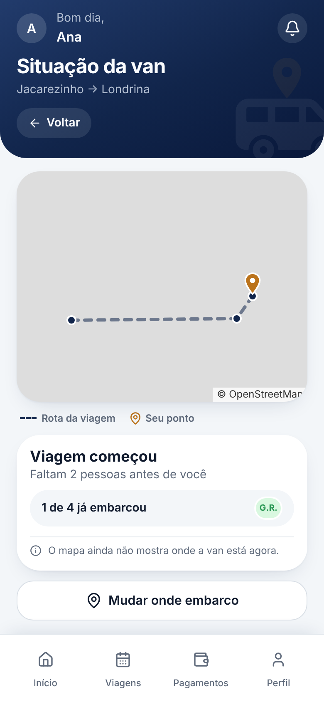

# Correção 4 — Mapa do passageiro (20/11/2026)

Branch `claude/correcao-4-mapa`, criada a partir de `claude/correcao-3-embarque` (`b426994`, que contém as Correções 1 e 2). Sem banco de produção, sem publicação, sem merge na `main`. Nenhuma mudança no banco.

## O que estava errado (provas)

| Problema | Prova antes da correção |
| --- | --- |
| Van inventada no mapa | `src/routes/passageiro.van.tsx` movia a van sozinha a cada segundo (`useProgresso`) e `src/lib/mapa.ts` (`vanSimulada`) calculava a posição sem dado real. No app (Chromium, banco simulado no navegador): **1 van desenhada** no mapa. |
| Previsão de chegada falsa | `textoDaChegada` (40 km/h sobre a posição inventada): **"Chega no seu ponto em 1 min"** e **"Está passando por Jacarezinho"**. |
| "Você é o próximo" sem a ordem real | Com o banco, o celular do passageiro só tem o próprio lugar na viagem (`viagemDoPassageiro`, ordem = só ele). A tela do mapa não aplicava o embarque real do banco e mostrava **"Você é o próximo"** enquanto o banco dizia **2 pessoas antes**. No Início, o mesmo acontecia se a consulta do embarque falhasse. |
| Erro de produção `_leaflet_pos` | `erros_do_app`: "Cannot read properties of undefined (reading '_leaflet_pos')". Causa confirmada no código do Leaflet 1.9.4: o zoom animado termina por um temporizador de 250 ms que `remove()` não cancela; depois do `remove()`, o temporizador lê o painel apagado. Reproduzido no Chromium com o componente do app: **20 de 20** fechamentos durante zoom por duplo toque e **20 de 20** durante zoom por foco (GPS/busca) deram o erro; sem animação, 0 de 20. |

## O que mudou

- **Retirado:** a van no mapa, o movimento simulado, "Está passando por…", "Chega no seu ponto em…" e o aviso de "posição simulada". Não há GPS nesta etapa.
- **Mantido (dados reais):** a rota (cidades em ordem), o ponto marcado pelo passageiro, a situação da van (a mesma do Início), a parada do café, o embarque real do banco ("1 de 4 já embarcou", iniciais) e "Faltam N antes de você" / "Você é o próximo" **só** quando a ordem real vem do banco.
- **Sem a ordem real:** "Viagem começou — A van está buscando os passageiros" (nada de posição na fila inventada).
- **Novos estados:** "Carregando o mapa…" enquanto as cidades são procuradas; "Não deu para carregar o mapa agora. Confira a internet. As informações da viagem continuam valendo."; sem destino, "Entre com o código do vanzeiro para ver a rota".
- **Clareza:** título "Situação da van" (antes "Onde está a van"), legenda do mapa (rota e seu ponto), aviso curto "O mapa ainda não mostra onde a van está agora.", a posição na fila aparece uma vez só, mapa com descrição para leitor de tela e painel anunciado como "Situação da viagem".
- **Erro do Leaflet:** ao fechar, o zoom em andamento é encerrado antes de destruir o mapa (`src/components/app/MapaDaVan.tsx`).

## Testes

| Teste | Resultado |
| --- | --- |
| `src/test/correcao4-mapa.test.tsx` (14) | 14/14: viagem não iniciada, em andamento (com e sem a ordem real), aguardando, embarcado, não estava no ponto, encerrada, sem coordenadas, carregando, sem destino, mudança de destino, painel sem nada fictício em 7 situações, abrir/fechar rápido e repetido |
| `scripts/laboratorio-mapa/fechar-durante-zoom.cjs` (Chromium) | **0/20** duplo toque, **0/20** foco, 0/20 sem animação; reabre e desenha a rota (antes: 20/20 e 20/20 com erro) |
| `scripts/laboratorio-mapa/percurso-passageiro.cjs` (app real no Chromium, Supabase simulado no navegador) | 17/17: Início → Situação da van → mapa → Voltar → abrir 3 vezes fechando durante zoom; rota e pino desenhados; "Faltam 2", "1 de 4", aviso; nada fictício; sem a ordem real nada inventado; "Carregando o mapa…"; aviso sem internet; nenhum erro no navegador |
| Tela "Onde você embarca" (mesmo componente) | mapa, pino, zoom e voltar sem erro |
| Tamanhos 390×844, 360×740, 375×667 | sem rolagem, sem rolagem lateral, botão acima da barra; mapa com 277, 157 e 122 px |
| App | 472 testes em 94 arquivos; tipos e build sem erro; lint 1.733 erros de formatação herdados (antes 1.771) e os mesmos 5 avisos |
| Banco (Correções 1–3) | C1 26/26, C2 17/17, C3 14/14; regressão 117 testes, 110 passaram, os mesmos 7 de correções futuras; financeiro 20/20; E3 28/28 |

## Limites

- Sem celular físico: navegador Chromium em tamanho de celular, com o Supabase simulado no navegador.
- As imagens do mapa (OpenStreetMap) não carregam neste ambiente sem internet; no celular aparecem normalmente. Sem internet no celular, o fundo do mapa fica cinza, mas a rota e o ponto continuam desenhados se as cidades já foram carregadas.
- As coordenadas de cidades fora dos exemplos ficam só na memória do app: ao reabrir sem internet, aparece o aviso de mapa indisponível.
- O banco já fornece a ordem real só durante a busca (`embarque_da_viagem`); nas outras fases o painel mostra a situação, sem posição na fila.
